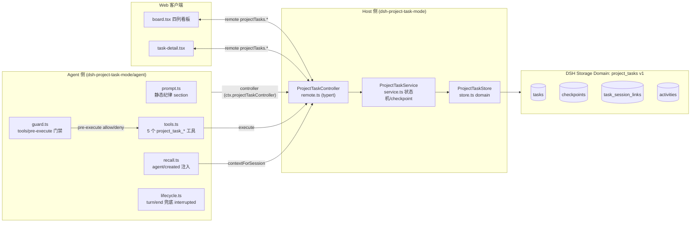
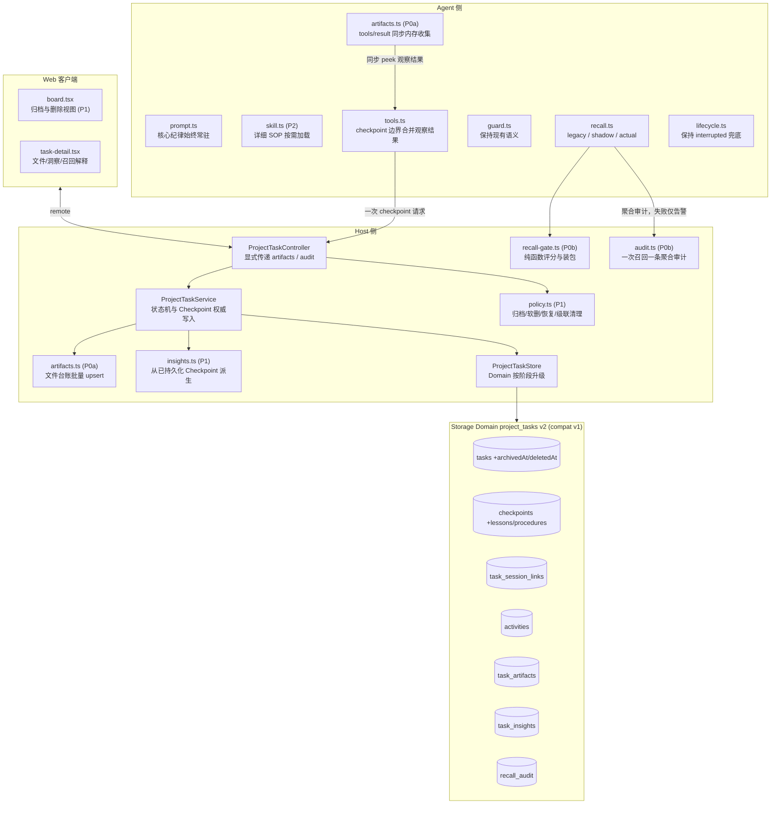
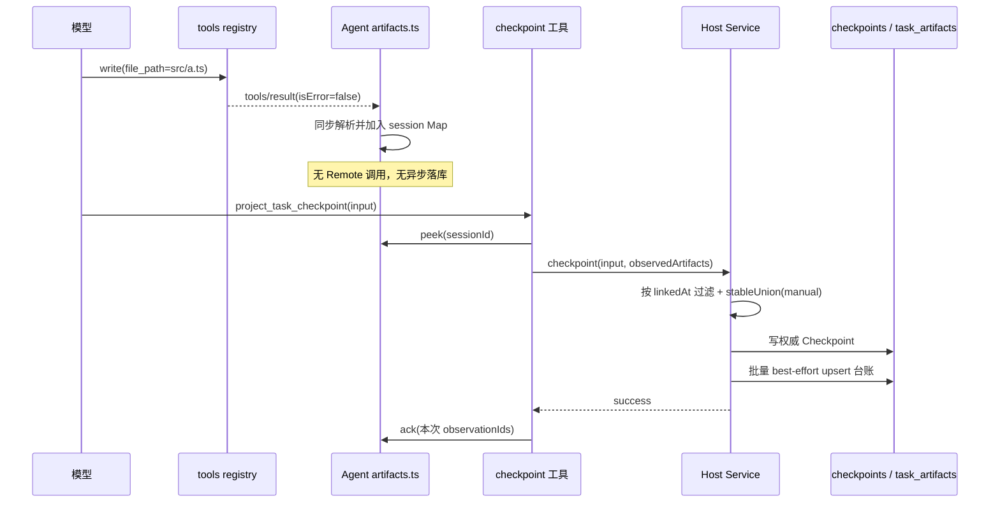
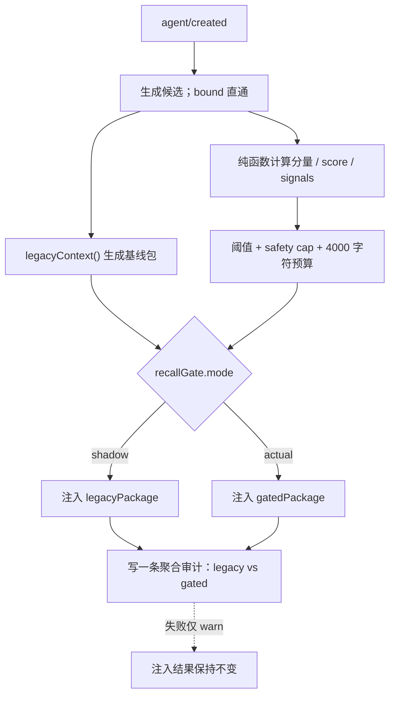
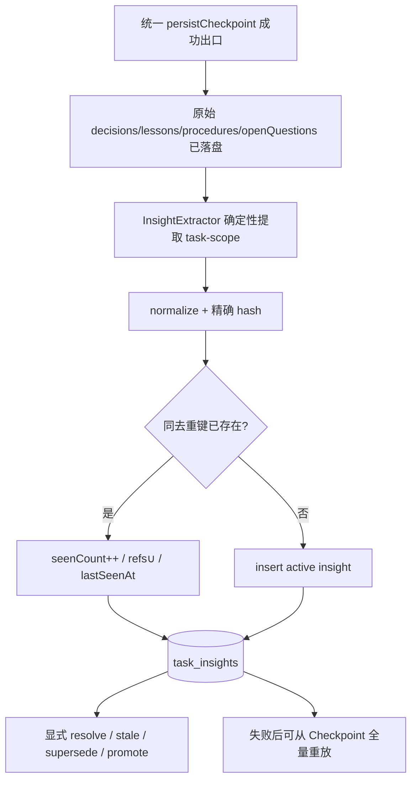
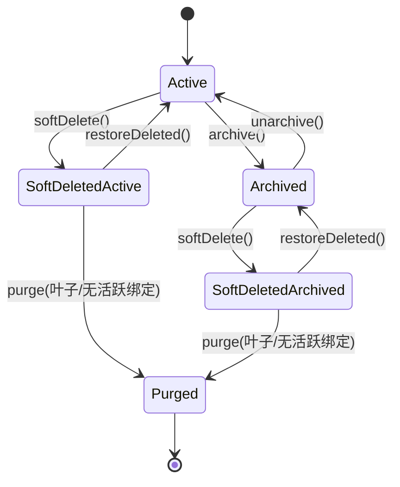

# 设计：将 dsh-project-memory 的可借鉴特性融入 dsh-project-task-mode

> 版本：设计稿 v2（评审修订版，对应 task-mode 0.1.18）
> 实施状态：F7 基线/fixture、F1 与 F2 shadow 已实现；F2 actual 仅保留配置与测试路径，F3/F4 行为及 F5/F6/F8 尚未实施。0.1.18 修复 F1 文件台账 key 违反 per-record 后端 SAFE_KEY（冒号→下划线）导致台账静默落盘失败的问题，并补充真实文件后端回归测试。
> 目标：把上一轮对比中提炼的「记忆层」能力，以最小侵入方式接入现有「任务流程层」，保持核心状态机语义稳定。
> 读者：要实现这批特性的工程师；需要理解“新模块挂在哪里、数据怎么变、老数据怎么办”。
> v2 修订重点：收窄 P0，修正工具 observer 与 Storage Domain 的能力边界，补齐洞察、归档和删除的生命周期。

---

## 0. 结论先行（TL;DR）

- **定位不变**：task-mode 仍是“任务流程层”。本次吸收 memory 的**可观测、可沉淀、可运维**能力，保持 `TRANSITIONS` 状态机、`revision` 乐观并发、验收分离、`interrupted` 兜底这些核心不变量。
- **边界（非目标）**：本方案不重建 memory 的知识索引、BM25+leanvec 语义检索和分片 JSON 存储；这些能力由 `dsh-project-memory` 插件承担。这里只设计与任务域强耦合的门控、审计、沉淀和治理机制。
- **先做可靠交接，再做召回门控，最后做长期记忆**：
  - **P0 / 基线**：F7 性能与行为基线、真实 v1 数据 fixture。
  - **P0a**：F1 文件自动沉淀，采用“Agent 同步收集 → Checkpoint 请求显式携带 → Host 持久化”。
  - **P0b**：F2 召回门控先跑 shadow；达到误过滤、token 和时延门槛后才切 actual。
  - **P1**：F3 分层洞察、F4 归档/容量/软删。两者先补齐数据生命周期，再进入实施。
  - **P2**：F6 用法 skill 化；F8 仅考虑 task-mode → memory 的单向投影。
  - **暂缓**：F5 跨实例锁。当前 Domain 没有跨进程原子获取与 CAS 语义，`revision` 也不承担跨进程强一致兜底。
- **存储采用 additive 目标 schema**：F1 首次落库时将 Storage Domain `project_tasks` 从 `version: 1` 升到 `2`，声明 `compatibleVersions: [1]`。F1–F4 的新增表和 optional 字段统一纳入 v2 目标 schema，各特性由开关分阶段启用；F5 锁表不纳入本设计。`invalidRecords` 保持严格默认值，避免派生数据的容错策略影响权威 task/checkpoint 数据。
- **核心调用约束**：`tools/result` 是 observe-only 事件，observer 的异步返回值不会被工具流水线等待。因此 F1 的 observer 只做同步内存收集，Checkpoint 才是持久化边界。

---

## 1. 现状架构（as-is）

现有三段式：**Host Service（领域数据 + 状态机）** + **Agent 侧（提示词 / 工具 / 门禁 / 召回 / 生命周期）** + **Web 客户端看板**，通过 typert remote 通信；存储走 DSH Storage Domain 的 `project_tasks` 四张表。



现有挂载点：

| 文件 | 关键位置 | 作用 |
|---|---|---|
| `src/index.ts:13-23` | Host `apply()`：`ProjectTaskStore.open → ProjectTaskService → ProjectTaskController`，`ctx.effect` 注册 typert 与 `store.close()` | Host 装配入口 |
| `src/host/store.ts:11-21` | `PROJECT_TASK_DOMAIN = defineDomain({...})` | 领域表声明与版本入口 |
| `src/host/store.ts:25-67` | `class ProjectTaskStore` | 表访问封装 |
| `src/host/service.ts:23-32` | `TRANSITIONS` 状态机 | 状态合法性 |
| `src/host/service.ts:180-214` | `update()` 使用 Domain 写链完成 read-modify-write，并递增 `revision` | 单进程乐观并发范式 |
| `src/host/service.ts:242-264` | `context()`：进行中≤3 / 阻塞≤2 / 交接≤2 | 召回包生成 |
| `src/host/service.ts:443-511` | `writeCheckpoint()`；`mutateTask=false` 分支会提前返回 | Checkpoint 持久化；F3 必须覆盖所有返回路径 |
| `src/host/remote.ts:87-97,148-156` | 从 `session.header.cwd` 解析 workspace；`contextForSession/activeTaskForSession` | Agent 会话与任务绑定 |
| `src/agent/index.ts:11-20` | Agent 装配入口 | 新监听器与 skill 的注册位置 |
| `src/agent/tools.ts:108-142` | `project_task_checkpoint.execute → controller.checkpointForSession` | F1 合并观察结果的同步调用边界 |
| `src/agent/recall.ts:63-71` | `agent/created → injectTaskContext` | F2 shadow/actual 的注入边界 |
| `src/agent/lifecycle.ts:24-52` | turn/end、error、disposed 兜底 | 现有 interrupted 语义保持不变 |
| `src/agent/prompt.ts:3-20` | 常驻提示词 | F6 的测量与拆分对象 |

### 1.1 已核实的框架契约

- 工具流水线为 `tools/pre-execute → guards → tools/execute → tools/post-execute → finalizeContent → tools/result`。
- `tools/result` 只观察冻结后的结果；实现会捕获 observer 的异步异常，但不会 await observer。F1 因此不能依赖“异步 upsert 一定早于下一次工具调用完成”。
- Agent 与 Host 通过 Controller/Remote 通信。Agent 进程内 Map 对 Host Service 不可见，跨层数据必须显式放进请求。
- Storage Domain 的 `compatibleVersions` 只声明哪些旧记录可被当前 schema 接受；旧记录不会被自动重写或迁移。
- `invalidRecords` 是 `DomainSpec` 级配置，不是逐表配置。
- Domain 的 `update` 保证当前进程内该 Domain 写链上的原子 read-modify-write；当前契约没有跨进程 CAS、锁或 fencing 承诺。
- Skill 可通过 `ctx.skills.register(SkillRegistration)` 注册；同名 runtime 注册采用 first-wins 并告警，重复注册场景不能只依赖异常回退。

---

## 2. 目标架构（to-be）

新增模块仍采用旁挂方式，但数据流遵守两条边界：**工具 observer 只做同步收集；权威写入只经 Host Service/Controller**。



ASCII 数据流兜底：

```
文件工具结果
  → Agent artifacts.ts 同步写入 session 级内存收集器
  → project_task_checkpoint.execute 取出本次观察快照
  → Controller/Remote 显式携带 observedArtifacts
  → Host 过滤任务绑定前的记录、合并 modifiedFiles、持久化 Checkpoint
  → task_artifacts 批量 best-effort upsert

agent/created
  → 同时计算 legacyPackage 与 gatedPackage
  → shadow 注入 legacyPackage；actual 注入 gatedPackage
  → 一次召回写一条聚合审计；审计失败不影响注入
```

F5 的 `task_locks`、心跳和退出 flush 不进入目标架构；未来若重启该方向，先另写原子锁与 fencing 设计。

---

## 3. 分阶段路线与优先级

| 顺序 | 阶段 | 内容 | 进入条件 | 完成证据 |
|---|---|---|---|---|
| 0 | **P0 / F7 基线** | 现有召回、Checkpoint、list/get 的延迟、字符量和写入次数；真实 v1 fixture | 无 | 基线报告、固定随机种子、运行环境、v1 打开/读/写回测试 |
| 1 | **P0a / F1** | 同步内存收集；Checkpoint 请求合并；`modifiedFiles` 权威兜底；文件台账 | 基线完成 | 紧接 Checkpoint 不丢文件；observer 无 Host 异步写；现有测试全绿 |
| 2 | **P0b / F2 shadow** | 纯函数评分；legacy/gated 双包；一次召回一条聚合审计 | F1 稳定 | shadow 仍注入 legacy；可比较误过滤、token、时延；审计写入 O(1)/次召回 |
| 3 | **P0b / F2 actual** | 灰度启用门控，保留快速切回 shadow/legacy 的开关 | shadow 达到 §10 门槛 | bound 直通；召回质量、预算、性能回归通过 |
| 4 | **P1 / F3** | 原始 lessons/procedures 持久化；task-scope 洞察；显式提升、解决与取代 | F2 稳定 | 派生失败可重放；start/claim 等所有 Checkpoint 路径均覆盖 |
| 5 | **P1 / F4** | archive/unarchive、softDelete/restoreDeleted、幂等 purge、保留策略 | 数据生命周期评审完成 | 关联数据清理、父子约束、活跃绑定与故障重试测试通过 |
| 6 | **P2 / F6** | 测量后拆分详细 SOP skill | 有明确 token 或维护收益 | 核心纪律仍常驻；未加载 skill 时 Checkpoint/验收行为稳定 |
| 7 | **P2 / F8 可选** | task-mode → memory 单向摘要投影 | 洞察模型稳定 | 幂等、可重建；memory 不回写任务 |
| — | **暂缓 / F5** | 跨实例互斥与退出 flush | 另有原子锁和 fencing 方案 | 两个真实进程竞争测试；本版不进入实施 |

发布建议：P0a 与 P0b shadow 可作为一个次要版本；F2 actual 单独灰度；F3/F4 分别评审和发布，避免把存储治理与召回行为变化捆在同一次发布中。

2026-11-05 首个实施增量已按上表 0–2 完成代码与专项测试：默认 `artifacts.enabled=true`、`recallGate.mode=shadow`。本增量只加入 F3 原始 `lessons/procedures` 字段和 F4 可选时间戳/schema，不启用洞察提取、归档、软删或 purge 行为。

---

## 4. 挂载点清单（实现索引）

| 特性 | 挂载文件 | 函数 / 位置 | 动作 |
|---|---|---|---|
| F7 | `scripts/benchmark-project-task.mjs`、`tests/fixtures/`（新） | — | 建立行为/性能基线与真实 v1 数据目录 |
| F1 | `src/agent/artifacts.ts`（新） | `ctx.on('tools/result')` | 同步解析并写入 session 级内存收集器；无 Remote/Host 异步调用 |
| F1 | `src/agent/tools.ts:108-142` | `project_task_checkpoint.execute` | peek 本次观察快照，调用扩展后的 Controller 方法；成功后仅确认已提交快照 |
| F1 | `src/host/remote.ts` | `checkpointForSession` | 显式接收内部 `observedArtifacts` 参数 |
| F1 | `src/host/service.ts:443-511` | `writeCheckpoint` | 按 Session 绑定时间过滤，合并 modifiedFiles，先写权威 Checkpoint，再批量 upsert 台账 |
| F2 | `src/host/recall-gate.ts`（新） | — | 纯函数生成 legacy/gated 包、决策摘要和字符量估算 |
| F2 | `src/agent/recall.ts:63-71` | `registerTaskRecall` | shadow 注入 legacy；actual 注入 gated；调用聚合审计 Remote |
| F2 | `src/host/service.ts`、`src/host/store.ts` | `persistRecallAudit` / `pruneRecallAudit` | Host 一次召回 best-effort 写一条审计；保留上限与清理 |
| F3 | `src/shared/types.ts`、`schemas.ts`、`contract.ts` | Checkpoint 类型与 wire schema | 同时扩展 `CheckpointInput` 和 `TaskCheckpoint` 的 lessons/procedures |
| F3 | `src/host/service.ts:443-511` | 统一 Checkpoint 持久化出口 | 所有分支在成功持久化后调用提取器，包括提前返回分支 |
| F3 | `src/host/insights.ts`（新） | — | 精确去重、作用域提升、resolved/superseded、重放 |
| F4 | `src/host/policy.ts`（新） | — | archive/unarchive、softDelete/restoreDeleted、幂等 purge |
| F4 | `src/host/service.ts`、`remote.ts`、`src/client/*` | list/context/UI | 统一可见性、操作入口与二次确认 |
| F6 | `src/agent/skill.ts`、`prompt.ts` | — | 详细 SOP 按需加载；核心纪律保留 |
| F8 | 独立包 `dsh-project-task-bridge` | — | 单向、幂等摘要投影 |

新增共享字段或 Remote 时，同步更新 `src/shared/types.ts`、`src/shared/schemas.ts`、`src/shared/contract.ts`、typert 契约与 Client 类型，避免只改 `remote.ts`。

---

## 5. 逐特性详细设计

### F1 文件自动沉淀（Auto Artifacts）— P0a

**目标**：降低手填 `modifiedFiles` 的遗漏。自动观察是 best-effort 增强，手工字段仍是权威输入之一；由于 P0 不解析 bash、生成器或外部进程写文件，交接语义是“更完整”，不是“完整覆盖所有改动”。

#### 5.1.1 同步收集器

1. Agent 新增 `registerArtifactTracking(ctx)`，监听 `tools/result`。
2. observer 内只执行同步步骤：
   - 要求 `result.isError === false`，且工具名属于 `write/edit/apply_patch/str_replace/multi_edit/delete/move`。
   - 按已知参数 schema 读取 `file_path/path/paths[]/old_path+new_path`。
   - 以 `session.header.cwd` 为根归一化为 workspace 相对路径；越界路径与解析失败记录 warn 并跳过。
   - 写入 `Map<sessionId, Map<observationId, ObservedArtifact>>`。每条含 `path/changeKind/observedAt/tool/sessionId`。
3. observer 不调用 `activeTaskForSession`，不写 Remote，不执行 upsert，也不依赖异步 flush。任务归属由 Host 在 Checkpoint 边界判定。
4. 每个 session 最多保留 500 条路径观察，超出时丢弃新观察并记录 `truncated=true`；Session 释放时清理内存。截断状态通过 Checkpoint 返回的 `TaskDetails.artifactObservationTruncated` 和看板文件台账提示展示，不改变任务状态或伪造 `handoffIncomplete`。

#### 5.1.2 Checkpoint 调用边界

`project_task_checkpoint.execute` 执行以下流程：

1. 同步 `peek(sessionId)` 获取不可变观察快照，不在请求前清空收集器。
2. 调用 `controller.checkpointForSession(sessionId, input, observedArtifacts)`。第三个参数属于 Agent↔Host 内部请求，不暴露为模型手填字段。
3. Host 根据当前 active task 与 `TaskSessionLink.linkedAt`，仅接受 `observedAt >= linkedAt` 且属于当前 session 的观察，避免把建任务前的文件归到新任务。
4. Host 计算 `modifiedFiles = stableUnion(observedPaths, input.modifiedFiles ?? [])`，并写入权威 `TaskCheckpoint`。
5. Checkpoint 成功后，Host 批量 best-effort upsert `task_artifacts`；台账失败只告警，权威 `modifiedFiles` 已保留文件集合。
6. Agent 收到成功结果后，仅确认本次快照中的 `observationId`；请求期间新产生的观察留给下一次 Checkpoint。失败时保留快照供重试。
7. 没有后续 Checkpoint 的观察只在当前进程内存在，正常退出仍由现有 `store.close()` 负责 Domain 关闭；本版不承诺进程退出时补写任务数据。



#### 5.1.3 验收

- 单元：覆盖各工具参数、路径归一化、重复观察、越界路径、500 条上限。
- 时序回归：文件工具结果返回后立即 Checkpoint，文件必须进入 `modifiedFiles`；测试中不存在依赖 observer 异步 upsert 的等待。
- 并发：Checkpoint 请求期间新增观察不会被本次 ack 误删。
- 归属：建任务/绑定前的观察不会归入当前任务；无 active task 时 Checkpoint 维持现有错误语义。
- 失败隔离：`isError=true` 不记；台账写失败不影响 Checkpoint；bash 与未识别工具保持跳过。
- 集成：不传手工 `modifiedFiles` 时自动文件可见；手工与自动路径去重且顺序稳定。

---

### F2 召回门控 + 聚合审计（Recall Gate & Audit）— P0b

**目标**：让召回集合可解释、可测量，再逐步替代固定上限。shadow 阶段的实际注入行为必须与基线一致。

#### 5.2.1 候选与 bound 直通

- 候选来自 `visibleTasks(workspaceId)`，默认排除 deleted/archived 及 done/cancelled。
- 自动候选包含 root task；存在 bound root 时，也包含其直接子任务。若未来需要更深后代，单独扩展候选生成器。
- `boundTask` 在评分前直通，始终进入 `boundTask` 字段，不参与归一化分数，也不受非 bound 预算裁剪。
- 既有四桶结构保持；既有 `inProgress≤3/blocked≤2/recentHandoffs≤2` 作为 safety cap 保留，门控只减少或重排候选。

#### 5.2.2 可复现评分

非 bound 候选的每个分量均在 `[0,1]`，初始 shadow 权重如下：

| 分量 | 权重 | 定义 |
|---|---:|---|
| `status` | 0.30 | in_progress 1.0 / blocked 0.9 / in_review 0.7 / paused 0.6 / todo 0.4 / backlog 0.2 |
| `recency` | 0.20 | `0.5^(ageDays/7)`，基于 `updatedAt`；只参与排序，不算支持信号 |
| `overlap` | 0.25 | 与 bound 任务标题、描述、最近摘要的词集 Jaccard；无参考文本时该信号不可用 |
| `child` | 0.10 | bound root 的直接子任务为 1，其余为 0；无 bound root 时不可用 |
| `handoff` | 0.15 | 最近 Checkpoint 含非空 nextSteps/openQuestions，或 kind 为 finish/handoff/interrupted 时为 1 |

```
score = 0.30*status + 0.20*recency + 0.25*overlap + 0.10*child + 0.15*handoff
```

- 排序键：`score DESC → updatedAt DESC → taskId ASC`，确保结果可复现。
- 支持信号只包括 `overlap>0`、`child=1`、`handoff=1`；`recency/status/bound` 均不计入 `minSignals`。
- `minSignals=1`。
- `supportRatio = 命中支持信号数 / 当前可用支持信号数`；无可用信号时记为 0。初始 shadow 阈值为 0.4，actual 阈值由 shadow 数据确认。
- `minScore=0.25` 是初始 shadow 参数，不作为未经验证的 actual 默认值。
- 非 bound 渲染预算默认 4000 字符，按实际渲染后的 section 长度计算；单项超出预算时记录 `budget-truncated`，不得截断 boundTask 的权威字段。

上述权重只用于第一轮 shadow 实验。`gateVersion` 随任何公式、权重或候选规则变化递增，审计之间只在相同 gateVersion 下直接比较。

#### 5.2.3 shadow / actual 语义

`RecallGate.evaluate()` 一次生成：

```
{
  legacyPackage,       // 完全按现有 context() 规则生成
  gatedPackage,        // 按评分、阈值、预算生成
  auditSummary         // 聚合结果，不含逐候选持久写
}
```

- `recallGate.enabled=false`：只计算并注入 legacy。
- `recallGate.mode=shadow`：计算两个包，**注入 legacyPackage**，审计记录 gated 与 legacy 的差异。
- `recallGate.mode=actual`：计算两个包，注入 gatedPackage；legacy 仅用于对比与快速回退。
- `autoContext=false`：沿用现有语义，不执行自动注入；它与 gate mode 是正交配置，不再借用 autoContext 表示 shadow。
- 公共 `context()` 返回所选 package；`TaskContextPackage` 四桶字段保持兼容。审计持久化放在 Agent 召回流程的独立 Remote 调用中，失败 catch + warn，不把 `context()` 改成依赖审计写盘的方法。

#### 5.2.4 聚合审计

一次召回至多写一条 `recall_audit`，内容包括：

- workspace/session/boundTask、mode、gateVersion、候选总数；
- legacy 与 gated 的 taskId 集合、估算/实际字符量；
- gated 入选项的分数、分量和 reasonCode；
- 拒绝原因计数，以及最多 20 条高分拒绝样本；
- 过滤差集：gated 相对 legacy 少注入的 taskId，用于评估误过滤。

每个 workspace 默认保留最近 200 条且最长 30 天；清理采用 best-effort 惰性执行。P0 不再为每个候选各写一条，也不同时维护第二个 JSONL 真相源。



#### 5.2.5 验收

- 金样测试：固定输入下逐项分数、总分、排序和 reasonCode 与公式一致。
- bound 在任何分数和预算下均直通；recency 单独无法构成支持信号。
- shadow 注入集合与 legacy 完全一致；actual 才使用 gated。
- 每次召回至多一条审计，10k 候选也保持 O(1) 条持久记录；审计大小有样本上限。
- 审计失败不阻断召回；保留策略限制审计增长。
- actual 的进入门槛见 §10，未达到时保持 shadow。

---

### F3 分层洞察 + 去重（Layered Insights）— P1

**目标**：从已持久化 Checkpoint 派生可重放的任务经验。Checkpoint 始终是权威原始事实，洞察是确定性派生数据，不引入第二套手工状态真相。

#### 5.3.1 原始输入先持久化

- `CheckpointInput` 与 `TaskCheckpoint` 同时新增 optional `lessons?: string[]`、`procedures?: string[]`。
- Host 先完成包含这些字段的 Checkpoint 持久化，再执行 InsightExtractor。提取器异常只告警，之后可通过全量重放重建。
- `writeCheckpoint` 收敛出统一的 `persistCheckpoint` 出口；`mutateTask=true/false`、start/claim、正常 finish 等所有成功路径都调用同一提取钩子，覆盖当前提前返回分支。
- 初版只处理 task scope 的 decision/lesson/procedure/question；相似度合并不进入首版。

#### 5.3.2 去重与使用语义

- `normalize`：小写、折叠空白、去 Markdown 标记与标点。
- 去重键：`workspaceId + scope + taskId? + kind + sha1(normalize(text))`。
- 重复时：保留信息更完整的原文，`seenCount++`，union `sourceRefs`（最多 50 个），更新 `lastSeenAt`。
- `lastUsedAt` 只在洞察实际被召回或被用户查询时更新；重复观察与使用分开计量。
- 原始 Checkpoint 永久保留原始文本；派生洞察被删除后可重放。

#### 5.3.3 作用域与生命周期

- 自动提取只进入当前 `task` scope。
- 提升到 `workspace` 或 `global` 需要用户显式操作，并记录 `promotedBy/promotedAt/originWorkspaceId`。
- `workspaceId` 始终表示来源工作区；workspace 洞察只参与该工作区召回。
- global 洞察默认不参与跨工作区自动注入。未来开启时必须有独立可见性开关与跨工作区评审，避免来源工作区内容隐式扩散。
- `openQuestions` 派生为 `kind=question,status=open`；后续 Checkpoint 未再提到它不代表已解决。
- 用户或 Agent 通过显式操作将 question 标记 `resolved/stale`；decision/lesson/procedure 通过 `supersededByInsightId` 表示被取代。只有 `status=active` 的洞察进入自动召回。
- `context()` 可在既有四桶之外追加 optional `projectInsights`，并受 F2 预算约束；boundTask 详情可追加 active task-scope insights。



#### 5.3.4 验收

- lessons/procedures 在原始 Checkpoint 中可读；提取器失败后重放结果一致。
- start/claim 等 `mutateTask=false` 路径也触发提取。
- 精确去重只更新 `lastSeenAt`；只有真实使用才更新 `lastUsedAt`。
- 自动提取不会产生 workspace/global 记录；提升有操作者与来源。
- resolved/stale/superseded 洞察不进入自动召回；question 不会仅因后续省略而自动解决。
- 删除全部派生洞察后，可由 Checkpoint 重建相同确定性结果。

---

### F4 归档 + 容量 + 软删（Archive / Capacity / Soft-delete）— P1

**目标**：提供可逆治理和明确的硬删边界。`archivedAt/deletedAt` 与 `status` 正交，但每个操作有独立语义。

#### 5.4.1 操作定义

| 操作 | 前置条件 | 效果 |
|---|---|---|
| `archive` | task 为 done/cancelled、无 activeSessionId、无未归档子任务 | 只设置 archivedAt/archivedBy |
| `unarchive` | 已归档且未软删 | 只清 archivedAt/archivedBy |
| `softDelete` | 无 activeSessionId、无未软删子任务 | 只设置 deletedAt/deletedBy；保留 archivedAt |
| `restoreDeleted` | 已软删 | 只清 deletedAt/deletedBy；原归档状态保持 |
| `purge` | 已软删、无 activeSessionId、叶子任务、expectedRevision 匹配 | 幂等清理关联数据，最后删除 task |

父子任务默认逐层治理，首版不提供隐式整棵子树删除。这样 purge 后不会留下悬空 `parentId/rootId`。若未来需要子树操作，应增加显式 `recursive=true`、影响预览和独立验收。

#### 5.4.2 purge 的幂等级联顺序

1. 删除 task-scope insights 与 artifacts。
2. 从 workspace/global 洞察的 `sourceRefs` 移除该 task/checkpoint 引用；用户显式提升且仍有正文的洞察可保留，但不得保留已清除的私有引用。
3. 删除包含该 task 的派生 recall_audit 记录。
4. 删除 checkpoints、task_session_links、activities。
5. 最后删除 tasks 中的 task 行。

任一步失败都保留可重试状态；重复执行已完成的步骤应得到相同结果。task 行最后删除，作为尚未完成 purge 的可发现标记。Remote 返回清理摘要，便于 UI 展示和故障排查。

#### 5.4.3 可见性与保留策略

- 所有 list/context/allTasks/看板读路径统一经过 `visibleTasks(workspaceId, opts)`。
- 默认排除 deleted；活动看板默认隐藏 archived；`includeArchived/includeDeleted` 只用于明确的管理视图。
- `autoArchiveDoneAfterDays=30` 只处理满足 archive 前置条件的 done 任务。
- `maxActiveTasksPerWorkspace=2000` 超限提示优先；自动淘汰只处理最老的 eligible done 任务。
- `purgeDeletedAfterDays=0` 默认关闭自动硬删；硬删由用户在 UI 二次确认后触发。



#### 5.4.4 验收

- restoreDeleted 保留原 archivedAt；unarchive 不清 deletedAt。
- 活跃绑定或非叶子任务的限制有明确错误码。
- purge 后所有关联表和派生引用均按规则清理；中途失败可安全重试。
- 所有读路径采用同一可见性规则，bound/Session 历史不出现悬空对象。
- 自动归档只处理 eligible done；自动硬删默认关闭。

---

### F5 跨实例锁 + 退出 flush — 暂缓

当前设计不实施 `task_locks`、心跳、进程退出补写或“revision 跨进程强一致兜底”。

原因：

1. `get → 判断 → put` 不是原子锁获取；两个调用可同时看到锁可用。
2. 当前 Domain 只提供进程内写链保证，没有跨进程 CAS。
3. TTL 锁还需要 fencing token，否则旧 owner 在锁过期后仍可能写入。
4. `beforeExit/SIGINT/disposed` 不能保证覆盖所有退出场景，不能作为权威 Checkpoint 的替代。

未来重启该特性时，单独提交设计，至少包含：支持原子获取的存储/锁后端、单调 fencing token、owner 续租、旧 writer 隔离、锁后端故障策略，以及两个真实进程的竞争/崩溃测试。现有 `revision` 继续承担单进程乐观并发语义。

---

### F6 用法 skill 化（Skill-ize the Playbook）— P2

当前常驻提示词规模较小，先用 F7 基线测量实际 token 与维护收益，再决定拆分范围。

- 始终常驻：副作用前建任务、Checkpoint 纪律、验收分离、中断状态、handoff 完整性等核心生命周期约束。
- 按需 skill：字段示例、交接模板、常见反模式、详细操作说明。
- 未加载 skill 时，核心 Checkpoint 与验收行为保持不变；guard 仍由代码执行。
- `ctx.skills.register` 的同名 first-wins 不是异常回退；装配应持有 disposer，并处理重复注册告警。注册能力缺失或初始化失败时保留现有 prompt。
- `useSkillPlaybook` 默认 false，测得实际收益后再灰度。

验收：核心规则常驻；未读 skill 的回归测试通过；报告实际常驻 token delta，而非只比较行数。

---

### F7 性能与行为基线（Benchmark Harness）— P0，前移

**目标**：在门控和审计之前建立可比较基线，避免用未经验证的绝对阈值代替回归证据。

#### 5.7.1 基线内容

- 数据规模：N=50/500/1k/5k/10k，每个任务配固定数量的 Checkpoint；固定随机种子。
- 操作：`list/get/context(legacy)/context(shadow)/context(actual)/checkpoint/artifact merge/audit write`。
- 指标：p50/p95/max、峰值内存、渲染字符数、每次召回持久记录数、每次 Checkpoint 写操作数。
- 输出：机器可读 JSON + Markdown；记录 Node 版本、OS、CPU、commit、配置与 gateVersion。
- 内存 store 用于确定性算法回归；真实后端另跑小规模持久化 smoke，避免把内存写延迟当作落盘延迟。

#### 5.7.2 回归门槛

- 基线阶段只记录现状，不预设跨机器通用的 `p95<50ms`。
- F2 shadow 的审计必须为 O(1) 条/次召回；10k 候选的审计正文大小受样本上限约束。
- F2 actual 相对 legacy 的 context p95 与 Checkpoint p95 回归预算，在首轮基线报告中确定；建议起始门限分别为 +10% 与 +20%，再按实测噪声调整。
- CI 使用同环境相对基线；绝对预算只作为指定运行环境的补充告警。

---

### F8（可选）任务桥接 memory — P2 / 独立包

- 仅做 **task-mode → memory** 的单向摘要投影；task-mode 是任务与状态的唯一权威来源。
- memory 侧 TaskBridge 不反向创建或更新 ProjectTask，避免双写与 ownership 冲突。
- 投影包含稳定 sourceId、sourceRevision、workspaceId 与摘要版本，支持幂等重放和删除后重建。
- 独立包、默认关闭；memory 服务缺失或版本不兼容时只停用投影，不影响 task-mode。

---

## 6. 数据模型变更

### 6.1 Domain 版本与严格读取

本设计将 F1–F4 的目标 schema 统一记为 v2。首个派生表落地阶段一次性完成 additive 表/字段声明，各特性仍由开关分阶段启用；后续新能力另升版本并扩展 compatibleVersions。F5 锁表不属于本设计。

```ts
export const PROJECT_TASK_DOMAIN = defineDomain({
  name: 'project_tasks',
  version: 2,
  compatibleVersions: [1],
  layout: 'per-record',
  // invalidRecords 保持严格默认值
  tables: {
    tasks: domainTable<string, ProjectTask>(projectTaskSchema),
    checkpoints: domainTable<string, TaskCheckpoint>(taskCheckpointSchema),
    task_session_links: domainTable<string, TaskSessionLink>(taskSessionLinkSchema),
    activities: domainTable<string, TaskActivity>(taskActivitySchema),
    task_artifacts: domainTable<string, TaskArtifact>(taskArtifactSchema),
    task_insights: domainTable<string, TaskInsight>(taskInsightSchema),
    recall_audit: domainTable<string, RecallAudit>(recallAuditSchema),
  },
})
```

- v1 记录缺省 optional 字段时按“未归档、未删除、无扩展字段”读取；读取本身不重写记录。
- 写回只设置当前操作拥有的字段，不能声称所有记录会自动补默认值。
- `invalidRecords='backup-and-skip'` 是 Domain 全局策略，本版不启用。若未来确需跳过坏掉的派生记录，将派生表拆到独立 Domain，使权威 tasks/checkpoints 继续保持严格。
- per-record v2 数据对仅接受 v1 的旧代码不可读；回滚以关闭功能开关为主，插件降级前先导出数据。

### 6.2 ProjectTask / TaskCheckpoint 扩展

```ts
export interface ProjectTask {
  /* 现有字段保持 */
  archivedAt?: number
  archivedBy?: TaskActor
  deletedAt?: number
  deletedBy?: TaskActor
}

export interface TaskCheckpoint {
  /* 现有字段保持 */
  lessons?: string[]
  procedures?: string[]
}

export interface CheckpointInput {
  /* 现有字段保持 */
  lessons?: string[]
  procedures?: string[]
}
```

### 6.3 Agent → Host 的 Checkpoint 观察参数

```ts
interface ObservedArtifactInput {
  observationId: string
  sessionId: string
  path: string
  changeKind: 'created' | 'modified' | 'deleted' | 'renamed'
  observedAt: number
  tool: string
}
```

该参数属于 Controller/Remote 内部请求，不加入模型可填写的 `project_task_checkpoint` schema。共享 types、zod schema、typert contract 同步更新。

### 6.4 新表 schema（zod 摘要）

```ts
// task_artifacts
z.object({
  id: z.string(),                 // taskId-sha1(normalizedPath)
  taskId: z.string(),
  workspaceId: z.string(),
  path: z.string(),
  changeKind: z.enum(['created','modified','deleted','renamed']),
  firstSeenAt: z.number(),
  lastSeenAt: z.number(),
  seenCount: z.number().int().nonnegative(),
  sourceCheckpointIds: z.array(z.string()).max(50),
  truncated: z.boolean().default(false),
})

// task_insights
z.object({
  id: z.string(),
  workspaceId: z.string(),        // 来源工作区
  originWorkspaceId: z.string(),
  scope: z.enum(['task','workspace','global']),
  taskId: z.string().optional(),  // scope=task 时必填
  kind: z.enum(['decision','lesson','procedure','question']),
  text: z.string(),
  normalized: z.string(),
  hash: z.string(),
  status: z.enum(['active','resolved','stale','superseded']),
  seenCount: z.number().int().nonnegative(),
  sourceRefs: z.array(z.string()).max(50),
  supersededByInsightId: z.string().optional(),
  promotedBy: taskActorSchema.optional(),
  promotedAt: z.number().optional(),
  createdAt: z.number(),
  updatedAt: z.number(),
  lastSeenAt: z.number(),
  lastUsedAt: z.number().optional(),
})

// recall_audit：一次召回一条聚合记录
z.object({
  id: z.string(),
  workspaceId: z.string(),
  sessionId: z.string(),
  boundTaskId: z.string().optional(),
  mode: z.enum(['legacy','shadow','actual']),
  gateVersion: z.string(),
  candidateCount: z.number().int().nonnegative(),
  legacyTaskIds: z.array(z.string()),
  gatedTaskIds: z.array(z.string()),
  removedFromLegacy: z.array(z.string()),
  admissions: z.array(z.object({
    taskId: z.string(),
    score: z.number(),
    components: z.record(z.string(), z.number()),
    reasonCodes: z.array(z.string()),
  })),
  rejectedCounts: z.record(z.string(), z.number().int().nonnegative()),
  rejectedSamples: z.array(z.object({
    taskId: z.string(),
    score: z.number(),
    reasonCodes: z.array(z.string()),
  })).max(20),
  legacyChars: z.number().int().nonnegative(),
  gatedChars: z.number().int().nonnegative(),
  createdAt: z.number(),
})
```

### 6.5 详情与召回扩展

- `TaskDetails` 新增 optional `artifacts?: TaskArtifact[]`、`recallAudit?: RecallAuditRecord[]`、`artifactObservationTruncated?: boolean`；`insights?: TaskInsight[]` 留待 F3。
- `TaskContextPackage` 保留既有四桶，新增 optional `projectInsights?: TaskContextInsight[]` 留待 F3。
- 所有新增数组在 Remote/UI 层设置上限；详情正文按需查询，避免把完整审计或全部洞察塞进默认召回。

---

## 7. 接口变更

### 7.1 Checkpoint 内部接口

```ts
checkpointForSession(
  sessionId: string,
  input: CheckpointInput,
  observedArtifacts?: ObservedArtifactInput[],
): Promise<TaskDetails>
```

现有模型工具的参数结构保持；扩展发生在 Agent 工具实现与 Controller/Remote 内部。Host 对观察参数执行 workspace、session、linkedAt、路径和数量校验。

### 7.2 召回与审计

- 新增内部评估接口 `contextEvaluationForSession`，返回 `{ legacyPackage, gatedPackage, audit }`；Agent 按模式选择注入包。
- Host 在评估接口内 best-effort 写入聚合审计并执行保留清理，不增加 Agent 补写审计的竞态窗口。
- 新增只读 `recallAudit({ taskId, limit? })`，返回该任务最近聚合记录；`TaskDetails` 携带最近 20 条，详情默认展示最近 5 条。

### 7.3 F3/F4 Remote

| 方法 | 入参 | 返回 | 说明 |
|---|---|---|---|
| `archive` | `{ taskId, expectedRevision }` | `TaskDetails` | 仅归档 eligible task |
| `unarchive` | `{ taskId, expectedRevision }` | `TaskDetails` | 只取消归档 |
| `softDelete` | `{ taskId, expectedRevision }` | `TaskDetails` | 软删并保留归档状态 |
| `restoreDeleted` | `{ taskId, expectedRevision }` | `TaskDetails` | 只恢复软删 |
| `purge` | `{ taskId, expectedRevision }` | `PurgeSummary` | 叶子、非活跃、已软删任务的幂等级联清理 |
| `listArchive` | `TaskQuery` | `TaskListResult` | 归档/软删管理视图 |
| `insights` | `{ taskId?, scope?, kind?, status? }` | `TaskInsight[]` | 限量查询 |
| `promoteInsight` | `{ insightId, scope, expectedRevision? }` | `TaskInsight` | 用户显式提升作用域 |
| `resolveInsight` / `supersedeInsight` | 对应 id 与状态参数 | `TaskInsight` | 显式生命周期操作 |

新增 Agent 工具保持可选；核心流程不依赖模型主动调用 insight/archive 工具。

---

## 8. UI 变更（`src/client`）

- `board.tsx`：增加活动/归档/软删管理视图；归档、取消归档、软删、恢复分别命名；purge 显示影响范围并二次确认。
- `task-detail.tsx`：
  - F1 文件台账：路径、变更类型、首/末见、次数、观察是否截断。
  - F2 召回解释：来自最近一次聚合审计，展示本任务分数、主要信号和 shadow/actual 差集；不展开全部候选。
  - F3 洞察：按 kind/status 分组；支持显式提升、resolve/stale、supersede；global 提升展示来源工作区。
  - F4 删除结果：展示 purge 清理摘要与可重试错误。
- `styles.ts` 复用现有 token，无新增依赖。
- 默认看板与详情请求不加载全量审计、洞察正文或 artifacts 历史。

---

## 9. 配置、兼容、迁移与回滚

### 9.1 功能开关

| 配置 | 初始状态 | 说明 |
|---|---|---|
| `artifacts.enabled` | true | 首个增量默认开启；关闭后只使用手工 modifiedFiles |
| `recallGate.enabled` | shadow 阶段开启 | 关闭时只走 legacy |
| `recallGate.mode` | `shadow` | 达到 §10 门槛后才灰度 `actual` |
| `recallGate.gateVersion` | 随公式递增 | 审计比较维度 |
| `autoContext` | 保持现有语义 | 是否自动注入，与 shadow 正交 |
| `insights.enabled` | F3 阶段开启 | 原始 Checkpoint 字段先兼容，派生可重建 |
| `archive.enabled` | F4 阶段开启 | 管理操作单独灰度 |
| `purgeDeletedAfterDays` | 0 | 默认关闭自动硬删 |
| `useSkillPlaybook` | false | 测量收益后开启 |
| `bridge.enabled` | false | 仅单向投影 |

本版没有 `lock.enabled` 与 `task_locks` 配置。

### 9.2 迁移与回滚

- 使用真实 v1 数据目录 fixture 验证：open → 读取 → 更新 → 重开，原有字段与状态保持。
- 新字段均为 optional；读路径处理字段缺省，写路径只修改当前操作拥有的字段。
- Domain 保持严格 invalidRecords 默认；坏记录显式暴露并备份处理。
- 功能回滚优先顺序：actual → shadow → legacy；F1 关闭自动收集；F3/F4 停止新写入但保留数据。
- v2 per-record 数据对旧版代码不可读。插件降级前必须导出；推荐关开关并保留新表。
- 多实例共享工作区仍属未解决场景；文档不得宣称 revision 或咨询锁已提供跨进程安全保障。

---

## 10. 测试计划与验收标准

| 层 | 测试 | 覆盖 |
|---|---|---|
| 基线 | 固定数据集生成 legacy 行为与性能报告 | F7 |
| fixture | 真实 v1 目录 open→读→写回→重开；严格坏记录测试 | 迁移 |
| 单元 | F1 参数解析、路径、数量上限、稳定去重 | F1 |
| 时序 | 文件工具后立即 Checkpoint；请求期间新增观察；失败重试 | F1 |
| 集成 | 无手工 modifiedFiles 的写文件→Checkpoint；台账失败隔离 | F1 |
| 金样 | F2 分量、总分、排序、信号、supportRatio、预算 | F2 |
| 集成 | shadow 注入与 legacy 完全一致；actual 才使用 gated | F2 |
| 容量 | 10k 候选一次召回至多一条审计；拒绝样本≤20；保留上限 | F2/F7 |
| 故障 | 审计写失败不影响注入；bound 始终直通 | F2 |
| 集成 | F3 原始 lessons/procedures 落盘；提取失败后重放 | F3 |
| 集成 | start/claim/mutateTask=false 的 Checkpoint 均触发提取 | F3 |
| 单元 | 去重 lastSeenAt、真实使用 lastUsedAt、resolved/superseded | F3 |
| 集成 | workspace/global 只能显式提升；global 无隐式跨工作区注入 | F3 |
| 单元 | F4 restore/unarchive 独立语义；活跃/父子前置条件 | F4 |
| 集成 | purge 清理所有关联记录；中途失败重试；task 最后删除 | F4 |
| 回归 | `npm test`、`npm run typecheck`、`npm run lint`、`npm run build` | 全量 |
| 性能 | 同环境相对基线；报告运行环境和写入次数 | F7 |

### F2 从 shadow 切 actual 的最低门槛

1. 固定评测集上的 bound 直通率 100%，现有核心场景无误过滤。
2. 对 shadow 标记的 `removedFromLegacy` 逐项抽样评审，确认过滤收益大于召回损失；样本集与结论随 gateVersion 存档。
3. 渲染字符量有明确下降或持平，且关键任务交接成功率无回归。
4. 同环境性能与写入量满足基线预算，审计保持 O(1) 条/次召回。
5. 已验证 actual → shadow → legacy 的运行时回退路径。

### 整体验收

1. P0 只包含基线、可靠 F1 和可测量 F2；长期洞察与治理在 P1。
2. 每项实施特性有挂载点、数据契约、失败语义和回归证据。
3. F1 无 observer 异步落库假设；F5 无跨进程强一致假设。
4. 架构图、路线、Remote、UI、配置、测试和风险表保持一致。
5. 核心状态机、验收分离、单进程 revision 语义与 interrupted 兜底保持。

---

## 11. 风险与取舍

| 风险 | 影响 | 对策 |
|---|---|---|
| F1 观察遗漏 bash/生成器改动 | 中 | 明确 best-effort；手工 modifiedFiles 保留；截断可见 |
| F1 Checkpoint 与观察竞态 | 高 | 同步收集、peek/ack、请求显式携带、Host 按 linkedAt 过滤 |
| F2 门控误过滤相关任务 | 高 | 先 shadow；bound 直通；差集审计；分阶段 actual 灰度 |
| F2 评分参数随经验漂移 | 中 | 纯函数、金样测试、gateVersion、固定评测集 |
| 聚合审计仍过大 | 中 | 拒绝样本≤20；每 workspace 200 条/30 天；O(1) 记录/次召回 |
| F3 派生失败或误去重 | 中 | 原始输入先落盘；确定性精确 hash；可重放；sourceRefs 保留 |
| workspace/global 经验扩散 | 高 | 自动提取仅 task；显式提升；global 默认不参与跨工作区召回 |
| F4 purge 留下关联数据或破坏父子树 | 高 | 叶子限制、幂等级联、task 最后删、失败重试 |
| Domain 容错误伤权威记录 | 高 | 严格默认；需要 skip 时拆独立派生 Domain |
| v2 数据降级不可读 | 中 | 关开关优先；降级前导出；真实 fixture 验证 |
| 多实例覆盖 | 高 | F5 暂缓并明确现状边界；未来采用原子锁 + fencing |
| skill 未加载导致纪律弱化 | 中 | 核心规则常驻；门禁代码化；测量后再灰度 |

**核心取舍**：先保证事实可靠和行为可测，再增加派生记忆。所有派生数据可重建，所有召回策略可回放，所有破坏性治理显式且可重试。

---

## 12. 附：与 memory 的对照速查

| memory 能力 | 本方案落点 | 阶段 |
|---|---|---|
| 文件自动沉淀 | F1 同步 observer + Checkpoint 请求合并 + task_artifacts | P0a |
| 混合语义召回（BM25 + leanvec） | 由 memory 插件承担 | 非目标 |
| 四阈值门控 + 预算熔断 | F2 可复现纯函数、legacy/gated 双包 | P0b |
| injection audit / shadow admission | F2 一次召回一条聚合审计；shadow 注入 legacy | P0b |
| insights 分层 + 内容哈希去重 | F3 原始 Checkpoint 可重放、显式提升与生命周期 | P1 |
| 归档 + 容量 + 软删 | F4 独立恢复语义与幂等 purge | P1 |
| 用法 skill 化 | F6 核心纪律常驻，详细 SOP 按需 | P2 |
| 跨实例目录锁 + 退出 flush | 当前契约下暂缓；未来原子锁 + fencing | 暂缓 |
| `bench:*` 性能基准 | F7 行为/性能基线与回归预算 | P0，前移 |
| TaskBridge 被动任务 | F8 task-mode → memory 单向投影 | P2，可选 |
